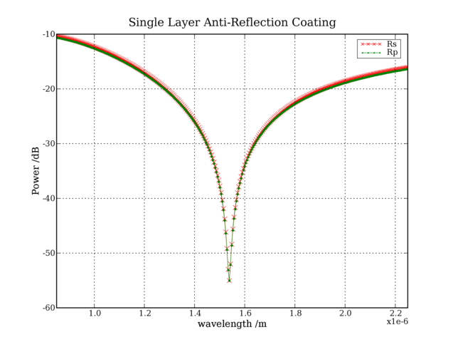
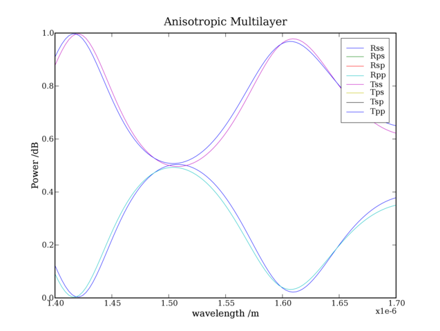
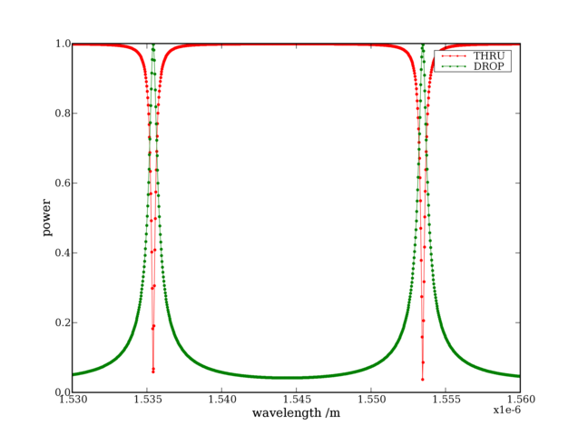
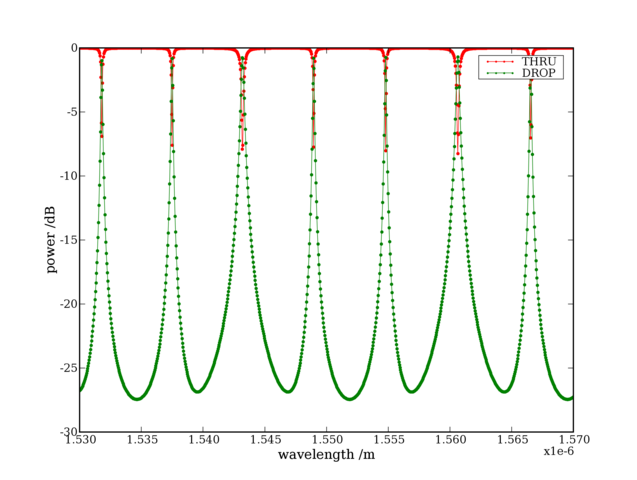
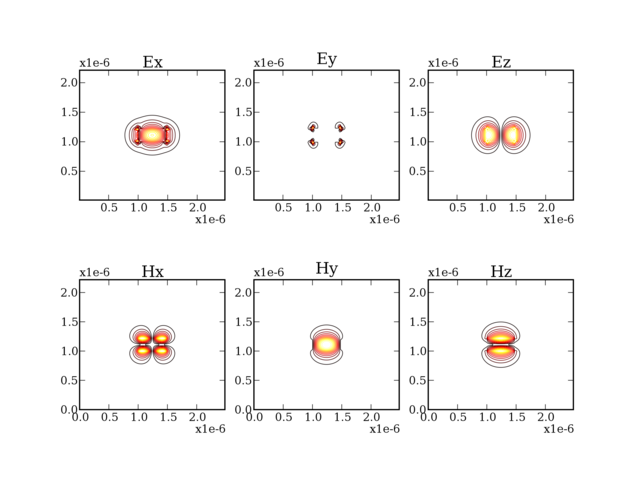
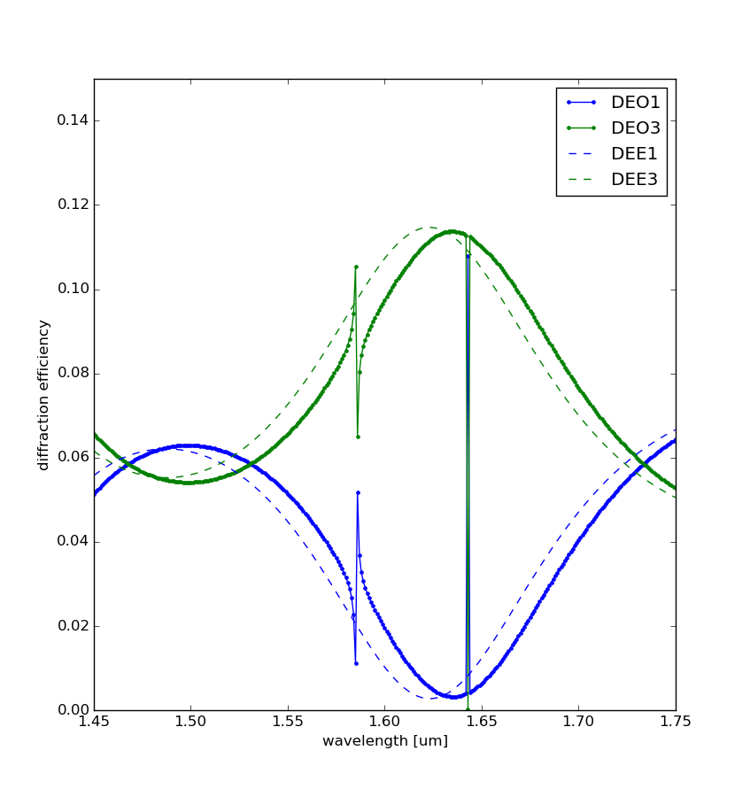

## EMpy

`EMpy` (ElectroMagnetic Python) (not to be confused with [empy](http://www.alcyone.com/software/empy/)) is a Python suite of numerical algorithms widely used in electromagnetism, photonics, and integrated optics: transfer matrix methods, rigorous coupled-wave analysis (RCWA), finite-difference and film-mode-matching waveguide mode solvers, coupled-resonator photonic circuits, liquid-crystal optics, and vector diffraction/scattering integrals.

**Contents:** [Implemented Algorithms](#algorithms) · [Testing & Verification](#testing) · [Examples](#examples) · [References](#references) · [Installation & Citation](#installation)

---

## Implemented Algorithms {#algorithms}

- **Transfer Matrix Method (`EMpy.transfer_matrix`):**
  - `IsotropicTransferMatrix`: 2 × 2 characteristic-matrix solver for s- and p-polarized plane waves in isotropic multilayers, including absorbing media, total internal reflection (TIR), and surface-plasmon resonance (SPR) geometries.
  - `AnisotropicTransferMatrix`: 4 × 4 Yeh–Berreman solver for arbitrarily oriented uniaxial, biaxial, twisted-nematic, and lossy anisotropic multilayers, solving the first-order Berreman eigenproblem with SVD nullspace polarization vectors, biaxial optic-axis / binormal degeneracy orthogonalization, and cross-mode-interference Poynting flux.
- **Rigorous Coupled-Wave Analysis (`EMpy.RCWA`):**
  - `IsotropicRCWA`: Planar and conical diffraction solver for multilayer surface-relief gratings (`BinaryGrating`, `SymmetricDoubleGrating`, `AsymmetricDoubleGrating`) based on Moharam's formulation, Lalanne's TM Fourier factorization, and Enhanced Transmittance Matrix (ETM) stabilization.
  - `AnisotropicRCWA`: 3D vector coupled-wave solver for arbitrarily Euler-rotated anisotropic gratings with isotropic or uniaxial end layers, Li's inverse-rule Fourier factorization for discontinuous permittivity tensors, and ETM recursion for thick high-order stacks.
- **Waveguide Mode Solvers & Junctions (`EMpy.modesolvers`):**
  - `FD` (`SVFDModeSolver`, `VFDModeSolver`): Semivectorial and full-vectorial 2D finite-difference mode solvers on non-uniform staggered grids, supporting symmetry walls, 5-component anisotropic permittivity tensors, complex-coordinate-stretching PML boundaries (`stretchmesh`), and shift-invert ARPACK eigensolvers.
  - `FMM` (`FMM1d`, `FMM2d`): 1D slab and 2D channel waveguide Film Mode Matching solvers expanding fields in slice eigenmodes with analytical sub-cell Poynting overlaps.
  - `geometries` & `interface` (`SWG`, `SimpleJoint`, `GenericDevice`): Mode-matching S-matrix and T-matrix cascades at waveguide discontinuities (offering both passive conjugated-Poynting mode matching and Lorentz-reciprocal unconjugated-reaction mode matching), plus staggered-grid FDTD mode-overlap helpers (`scripts/FDTD.py`).
- **Photonic Devices, Scattering, Materials & Liquid Crystals (`EMpy.devices`, `EMpy.scattering`, `EMpy.materials`, `EMpy.utils`):**
  - `devices`: Transfer- and chain-matrix models for directional couplers (`Coupler`), delay lines (`Line`), Mach–Zehnder interferometers (`MZ`), single and N-coupled ring resonators (`APRR`, `SRR`, `NRR`), tunable multi-coupler ring filters (`T_TCRR`, `T_CRTCRR`, `T_CTCRR`), dispersive/lossy Fabry–Pérot cavities (`Etalon`), and silicon strip waveguide dispersion (`SWG`).
  - `scattering`: 3D Kottler–Stratton–Chu vector surface-current radiation and scattering integral (`currentsScatteringKottler`).
  - `materials` & `utils`: Constant, polynomial, Sellmeier, tabulated (interpolated), and thermo-optic `IsotropicMaterial`, `AnisotropicMaterial`, and `LiquidCrystal` models, together with `LiquidCrystalCell` (coupled 1D Oseen–Frank elastic free-energy and Laplace electrostatic BVP solver with pretilt, twist, chiral pitch, and voltage).

---

## Testing & Verification Strategy {#testing}

`EMpy`'s test suite (`tests/`) validates numerical implementations against analytical electrodynamics and physical invariants:

1. **Consistent Harmonic & Passive Loss Convention:**
   - All solvers follow `exp(+iωt - ik·r)` with passive complex refractive index `n = n_r - iκ` (`κ ≥ 0`), passive square-root branch selection (`Re(k_z) - Im(k_z) ≥ 0`) across propagating, evanescent/TIR, and negative-`ε_r` regimes, and general complex-symmetric linear algebra (`M = Mᵀ`) without spurious Hermitian conjugation.
2. **Conservation Laws, Passivity & Reciprocity:**
   - *Lossless structures:* Exact energy conservation and unitarity (`R + T = 1`, `sum(DE1 + DE3) = 1`, `Sᴴ S = I`, `|THRU|² + |DROP|² = 1`).
   - *Passive lossy structures (`κ > 0`):* Strict passivity (`R + T ≤ 1`, `‖S‖₂ ≤ 1`, Beer–Lambert modal attenuation `|exp(-iβL)| < 1`) and Lorentz reciprocity (`S = Sᵀ` whenever `ε = εᵀ`).
3. **Degenerate-Limit Continuity:**
   - *Anisotropic → Isotropic (`Δn → 0`):* Every anisotropic solver (`AnisotropicMaterial`, `LiquidCrystalCell`, `AnisotropicTransferMatrix`, `AnisotropicRCWA`, 5-component `VFDModeSolver`) is tested against the corresponding isotropic solver both via explicit isotropic tensors (`ε = ε₀ n² I₃` bypassing `isIsotropic()` shortcuts) and along weak-birefringence sequences (`Δn ∈ {1e-4, 1e-8, 0}`) with arbitrary 3D Euler rotations, optic-axis / binormal degeneracies, normal-incidence azimuthal limits (`α → 0⁺, δ ≠ 0`), and `n = 0` / homogeneous grating limits.
   - *Lossy → Lossless (`κ → 0⁺`):* Lossy code paths are tested both at complex zero-loss dtype (`n = n_r + 0.0j`) and along continuous `κ → 0⁺` sequences against strictly real lossless paths across propagating, sub-cutoff, PML, and TIR regimes.
4. **Independent Cross-Solver & Analytical Benchmarks:**
   - Verified against Fresnel/Brewster/Airy equations, Kretschmann SPR dips, Jones waveplate calculus, Gooch–Tarry twisted-nematic transmission, Rytov subwavelength effective-medium theory, 1D slab dispersion relations, 2D Gauss–Legendre quadrature, and pointwise Maxwell curl/divergence equations, as well as CI runs across Python 3.10–3.14, `lowest-direct` dependency bounds, and all `examples/ex_*.py` scripts.

---

## Examples {#examples}

More (and more up-to-date) examples are [available in the source code](https://github.com/lbolla/EMpy/tree/master/examples).

Here are some simple examples of EMpy's functionalities:

- [Single Layer Anti-Reflection Coating](#example_slarc)
- [Anisotropic Multilayer](#example_am)
- [Single Ring Resonator](#example_srr)
- [N-Rings Resonator](#example_nrr)
- [Finite Difference Fully Vectorial Modesolver](#example_modesolver)
- [Multilayer with grating](#example_RCWA)

### Single Layer Anti-Reflection Coating {#example_slarc}

The isotropic transfer matrix algorithm can be used to study [anti-reflection coatings](https://en.wikipedia.org/wiki/Anti-reflective_coating). A very simple single layer anti-reflection coating, described [here](http://hyperphysics.phy-astr.gsu.edu/hbase/phyopt/antiref.html#c1), is computed by the following script ([`examples/ex_transfer_matrix_2.py`](https://github.com/lbolla/EMpy/blob/master/examples/ex_transfer_matrix_2.py)):

```python
from matplotlib import pyplot as plt
import numpy

import EMpy

# define multilayer
n = numpy.array([1.0, 1.38, 1.9044])
d = numpy.array([numpy.inf, 387.5e-9 / 1.38, numpy.inf])
iso_layers = EMpy.utils.Multilayer()
for i in range(n.size):
    n0 = EMpy.materials.RefractiveIndex(n[i])
    iso_layers.append(
        EMpy.utils.Layer(EMpy.materials.IsotropicMaterial("mat", n0=n0), d[i])
    )

# define incident wave plane
theta_inc = EMpy.utils.deg2rad(10.0)
wls = numpy.linspace(0.85e-6, 2.25e-6, 300)

# solve
tm = EMpy.transfer_matrix.IsotropicTransferMatrix(iso_layers, theta_inc)
solution_iso = tm.solve(wls)

# plot
plt.figure()
plt.plot(
    wls,
    10 * numpy.log10(solution_iso.Rs),
    "rx-",
    wls,
    10 * numpy.log10(solution_iso.Rp),
    "g.-",
)
plt.legend(("Rs", "Rp"))
plt.title("Single Layer Anti-Reflection Coating")
plt.xlabel("wavelength /m")
plt.ylabel("Power /dB")
plt.grid()
plt.xlim(wls.min(), wls.max())
plt.show()
```

In lines 7–14, the multilayer is defined. Indices and thicknesses are chosen so that a single layer of refractive index 1.38 and thickness about one quarter of the central wavelength 1.55 µm is positioned between two semi-infinite layers of air and glass. This gives theoretically no reflection for the central wavelength. The following graph is the result, which confirms the theoretical predictions.



The graph shows two curves, one for each polarization. They differ because the incident plane wave is tilted by 10 degrees (line 17).

[back to examples](#examples)

### Anisotropic Multilayer {#example_am}

The anisotropic transfer-matrix algorithm can be used to study the following example ([`examples/ex_transfer_matrix_3.py`](https://github.com/lbolla/EMpy/blob/master/examples/ex_transfer_matrix_3.py)):

```python
from matplotlib import pyplot as plt
import numpy

import EMpy

# define the multilayer
epsilon = [
    1.0**2 * EMpy.constants.eps0 * numpy.eye(3),
    EMpy.constants.eps0 * numpy.diag([2.1, 2.0, 1.9]),
    2.3**2 * EMpy.constants.eps0 * numpy.eye(3),
    4.3**2 * EMpy.constants.eps0 * numpy.eye(3),
    3.0**2 * EMpy.constants.eps0 * numpy.eye(3),
]

d = numpy.array([numpy.inf, 1e-6, 2.3e-6, 0.1e-6, numpy.inf])

aniso_layers = EMpy.utils.Multilayer()
for i in range(len(epsilon)):
    eps = EMpy.materials.EpsilonTensor(epsilon[i] * numpy.eye(3))
    mat = EMpy.materials.AnisotropicMaterial("layer_%d" % i, eps)
    layer = EMpy.utils.Layer(mat, d[i])
    aniso_layers.append(layer)

# define the planewave
theta_inc_x = EMpy.utils.deg2rad(0.0)
theta_inc_y = 0.0
wls = numpy.linspace(1.4e-6, 1.7e-6, 100)

# solve
tm = EMpy.transfer_matrix.AnisotropicTransferMatrix(
    aniso_layers, theta_inc_x, theta_inc_y
)
solution_aniso = tm.solve(wls)

# plot
plt.figure()
plt.plot(
    wls,
    solution_aniso.R[0, 0, :],
    wls,
    solution_aniso.R[1, 0, :],
    wls,
    solution_aniso.R[0, 1, :],
    wls,
    solution_aniso.R[1, 1, :],
    wls,
    solution_aniso.T[0, 0, :],
    wls,
    solution_aniso.T[1, 0, :],
    wls,
    solution_aniso.T[0, 1, :],
    wls,
    solution_aniso.T[1, 1, :],
)
plt.legend(("Rss", "Rps", "Rsp", "Rpp", "Tss", "Tps", "Tsp", "Tpp"))
plt.title("Anisotropic Multilayer")
plt.xlabel("wavelength /m")
plt.ylabel("Power /dB")
plt.xlim(wls.min(), wls.max())
plt.show()
```

The result is shown in the following graph.



Four curves are clearly visible because the two polarizations behave in a different way, even though the incidence is normal (lines 25–26), because of the anisotropic material (line 9).

[back to examples](#examples)

### Single Ring Resonator {#example_srr}

This is the script to study a single [ring resonator](https://en.wikipedia.org/wiki/Optical_ring_resonators) ([`examples/ex_SRR.py`](https://github.com/lbolla/EMpy/blob/master/examples/ex_SRR.py)):

```python
"""Single ring resonator example."""

from matplotlib import pyplot as plt
import numpy

import EMpy

wls = numpy.linspace(1.53e-6, 1.56e-6, 1000)
K1 = EMpy.devices.Coupler(wls, numpy.sqrt(0.08), 1.0)
K2 = EMpy.devices.Coupler(wls, numpy.sqrt(0.08), 1.0)
l1 = numpy.pi * 5e-6
l2 = numpy.pi * 5e-6
SWG = EMpy.devices.SWG(488, 220, 25).solve(wls)
SRR = EMpy.devices.SRR(K1, K2, SWG.neff, l1, l2).solve()

plt.plot(wls, numpy.absolute(SRR.THRU), "r.-", wls, numpy.absolute(SRR.DROP), "g.-")
plt.axis("tight")
plt.ylim([0, 1])
plt.xlabel("wavelength /m")
plt.ylabel("power")
plt.legend(("THRU", "DROP"))
plt.show()
```

In lines 9 and 10, the two coupling coefficients and the two coupler losses are defined. The half-roundtrip lengths of the ring are defined in lines 11 and 12, while its effective index is that of a silicon rib waveguide of 488 nm × 220 nm at room temperature.

This is its spectrum:



The maximum drop power is 0 dB (1 in linear units) because no losses are considered, and it is periodic with the period being the FSR of the ring.

[back to examples](#examples)

### N-Rings Resonator {#example_nrr}

This is the script to study a ring resonator made of 3 rings ([`examples/ex_NRR.py`](https://github.com/lbolla/EMpy/blob/master/examples/ex_NRR.py)):

```python
"""N-Ring resonators example."""

from matplotlib import pyplot as plt
import numpy

import EMpy

wls = numpy.linspace(1.53e-6, 1.57e-6, 1000)

Ks = [
    EMpy.devices.Coupler(wls, numpy.sqrt(0.08), 1.0),
    EMpy.devices.Coupler(wls, numpy.sqrt(0.008), 1.0),
    EMpy.devices.Coupler(wls, numpy.sqrt(0.006), 1.0),
    EMpy.devices.Coupler(wls, numpy.sqrt(0.09), 1.0),
]

R = 5e-6
l1s = [numpy.pi * R, numpy.pi * R, numpy.pi * R]
l2s = [numpy.pi * R, numpy.pi * R, numpy.pi * R]

SWG = EMpy.devices.SWG(400, 220, 125).solve(wls)
neffs = [SWG.neff, SWG.neff, SWG.neff]

NRR = EMpy.devices.NRR(Ks, neffs, l1s, l2s).solve()

plt.plot(
    wls,
    20 * numpy.log10(numpy.absolute(NRR.THRU)),
    "r.-",
    wls,
    20 * numpy.log10(numpy.absolute(NRR.DROP)),
    "g.-",
)
plt.axis("tight")
plt.ylim([-30, 0])
plt.xlabel("wavelength /m")
plt.ylabel("power /dB")
plt.legend(("THRU", "DROP"))
plt.show()
```

After the imports, a list of couplers is defined: four, in this case, because the resonator is made of 3 rings. Then, the arcs connecting the resonators are defined: the rings are all equal, and the couplers are on the diameters of the rings. Finally, the rings have an effective index equal to a 400 nm × 220 nm straight waveguide at 125 degrees.

This is its spectrum:



The drop is always lower than 0 dB because the coupling coefficients are not optimized.

[back to examples](#examples)

### Finite Difference Fully Vectorial Modesolver {#example_modesolver}

This is the script to find the first two modes of a channel SOI waveguide ([`examples/ex_modesolver.py`](https://github.com/lbolla/EMpy/blob/master/examples/ex_modesolver.py)):

```python
"""Fully vectorial finite-difference mode solver example."""

from matplotlib import pyplot as plt
import numpy

import EMpy


def epsfunc(x_, y_):
    """Return a matrix describing a 2d material.

    :param x_: x values
    :param y_: y values
    :return: 2d-matrix
    """
    xx, yy = numpy.meshgrid(x_, y_)
    return numpy.where(
        (numpy.abs(xx.T - 1.24e-6) <= 0.24e-6) * (numpy.abs(yy.T - 1.11e-6) <= 0.11e-6),
        3.4757**2,
        1.446**2,
    )


wl = 1.55e-6
x = numpy.linspace(0, 2.48e-6, 125)
y = numpy.linspace(0, 2.22e-6, 112)

neigs = 2
tol = 1e-8
boundary = "0000"

solver = EMpy.modesolvers.FD.VFDModeSolver(wl, x, y, epsfunc, boundary).solve(
    neigs, tol
)

fig = plt.figure()

fig.add_subplot(1, 3, 1)
Ex = numpy.transpose(solver.modes[0].get_field("Ex", x, y))
plt.contourf(x, y, abs(Ex), 50)
plt.title("Ex")

fig.add_subplot(1, 3, 2)
Ey = numpy.transpose(solver.modes[0].get_field("Ey", x, y))
plt.contourf(x, y, abs(Ey), 50)
plt.title("Ey")

fig.add_subplot(1, 3, 3)
Ez = numpy.transpose(solver.modes[0].get_field("Ez", x, y))
plt.contourf(x, y, abs(Ez), 50)
plt.title("Ez")

fig.add_subplot(1, 3, 1)
Hx = numpy.transpose(solver.modes[0].get_field("Hx", x, y))
plt.contourf(x, y, abs(Hx), 50)
plt.title("Hx")

fig.add_subplot(1, 3, 2)
Hy = numpy.transpose(solver.modes[0].get_field("Hy", x, y))
plt.contourf(x, y, abs(Hy), 50)
plt.title("Hy")

fig.add_subplot(1, 3, 3)
Hz = numpy.transpose(solver.modes[0].get_field("Hz", x, y))
plt.contourf(x, y, abs(Hz), 50)
plt.title("Hz")

plt.show()
```

This is a screenshot of the first (TE) mode:



[back to examples](#examples)

### Multilayer with grating {#example_RCWA}

This is the script to study the reflectivity of a grating embedded in an anisotropic multilayer ([`examples/ex_RCWA.py`](https://github.com/lbolla/EMpy/blob/master/examples/ex_RCWA.py)). The multilayer is made of 7 layers, the 4th being a binary grating made with an anisotropic material (SiN, rotated with the optical axis not aligned with the coordinate axis) and an isotropic material (BPTEOS). Incidence is not normal. A comparison of the reflectivity is made with a similar multilayer, where the grating layer has been substituted by an "effective" isotropic layer.

```python
"""Rigorous Coupled Wave Analysis example."""

from matplotlib import pyplot as plt
import numpy

import EMpy
from EMpy.materials import (
    IsotropicMaterial,
    AnisotropicMaterial,
    RefractiveIndex,
    EpsilonTensor,
)

alpha = 0.0
delta = 0.0
psi = EMpy.utils.deg2rad(70.0)  # hybrid
phi = EMpy.utils.deg2rad(90.0)

LAMBDA = 1016e-9  # grating periodicity
n = 2  # orders of diffraction

UV6 = IsotropicMaterial("UV6", n0=RefractiveIndex(n0_const=1.560))
SiN = AnisotropicMaterial(
    "SiN",
    epsilon_tensor=EpsilonTensor(
        epsilon_tensor_const=EMpy.constants.eps0
        * EMpy.utils.euler_rotate(
            numpy.diag(numpy.asarray([1.8550, 1.8750, 1.9130]) ** 2),
            EMpy.utils.deg2rad(14),
            EMpy.utils.deg2rad(25),
            EMpy.utils.deg2rad(32),
        )
    ),
)
BPTEOS = IsotropicMaterial("BPTEOS", n0=RefractiveIndex(n0_const=1.448))
ARC1 = IsotropicMaterial("ARC1", n0=RefractiveIndex(n0_const=1.448))

EFF = IsotropicMaterial("EFF", n0=RefractiveIndex(n0_const=1.6))

multilayer1 = EMpy.utils.Multilayer(
    [
        EMpy.utils.Layer(EMpy.materials.Air, numpy.inf),
        EMpy.utils.Layer(SiN, 226e-9),
        EMpy.utils.Layer(BPTEOS, 226e-9),
        EMpy.utils.BinaryGrating(SiN, BPTEOS, 0.659, LAMBDA, 123e-9),
        EMpy.utils.Layer(SiN, 219e-9),
        EMpy.utils.Layer(EMpy.materials.SiO2, 2188e-9),
        EMpy.utils.Layer(EMpy.materials.Si, numpy.inf),
    ]
)

multilayer2 = EMpy.utils.Multilayer(
    [
        EMpy.utils.Layer(EMpy.materials.Air, numpy.inf),
        EMpy.utils.Layer(SiN, 226e-9),
        EMpy.utils.Layer(BPTEOS, 226e-9),
        EMpy.utils.Layer(IsotropicMaterial(n0=RefractiveIndex(n0_const=1.6)), 123e-9),
        EMpy.utils.Layer(SiN, 219e-9),
        EMpy.utils.Layer(EMpy.materials.SiO2, 2188e-9),
        EMpy.utils.Layer(EMpy.materials.Si, numpy.inf),
    ]
)

wls = numpy.linspace(1.45e-6, 1.75e-6, 301)

solution1 = EMpy.RCWA.AnisotropicRCWA(multilayer1, alpha, delta, psi, phi, n).solve(wls)
solution2 = EMpy.RCWA.AnisotropicRCWA(multilayer2, alpha, delta, psi, phi, n).solve(wls)

um = 1e-6
plt.plot(
    wls / um,
    solution1.DEE1[n, :],
    "b.-",
    wls / um,
    solution1.DEE3[n, :],
    "g.-",
    wls / um,
    solution2.DEE1[n, :],
    "b--",
    wls / um,
    solution2.DEE3[n, :],
    "g--",
)
plt.xlabel("wavelength [um]")
plt.ylabel("diffraction efficiency")
plt.legend(("DEO1", "DEO3", "DEE1", "DEE3"))
plt.axis("tight")
plt.ylim([0, 0.15])
plt.show()
```

The reflectivities are shown in the picture below (in dashed lines is the reflectivity without the grating): the effect of the grating is clearly visible as a peak in the reflectivity.



[back to examples](#examples)

---

## References {#references}

- D. W. Berreman, "Optics in stratified and anisotropic media: 4 × 4-matrix formulation," *J. Opt. Soc. Am.* **62**(4), 502–510 (1972).
- P. Yeh, "Electromagnetic propagation in birefringent layered media," *J. Opt. Soc. Am.* **69**(5), 742–756 (1979); *Optical Waves in Layered Media* (Wiley, 1988).
- E. N. Glytsis and T. K. Gaylord, "Three-dimensional (vector) rigorous coupled-wave analysis of anisotropic grating diffraction," *J. Opt. Soc. Am. A* **7**(8), 1399–1410 (1990).
- M. G. Moharam, E. B. Grann, D. A. Pommet, and T. K. Gaylord, "Formulation for stable and efficient implementation of the rigorous coupled-wave analysis of binary gratings," *J. Opt. Soc. Am. A* **12**(5), 1068–1076 (1995).
- M. G. Moharam, D. A. Pommet, E. B. Grann, and T. K. Gaylord, "Stable implementation of the rigorous coupled-wave analysis for surface-relief gratings: enhanced transmittance matrix approach," *J. Opt. Soc. Am. A* **12**(5), 1077–1086 (1995).
- P. Lalanne and G. M. Morris, "Highly improved convergence of the coupled-wave method for TM polarization," *J. Opt. Soc. Am. A* **13**(4), 779–784 (1996).
- L. Li, "Use of Fourier series in the analysis of discontinuous periodic structures," *J. Opt. Soc. Am. A* **13**(9), 1870–1876 (1996); "Reformulation of the Fourier modal method for surface-relief gratings made with anisotropic materials," *J. Mod. Opt.* **45**(7), 1313–1334 (1998).
- A. B. Fallahkhair, K. S. Li, and T. E. Murphy, "Vector finite difference modesolver for anisotropic dielectric waveguides," *J. Lightwave Technol.* **26**(11), 1423–1431 (2008).
- A. S. Sudbø, "Film mode matching: a versatile numerical method for vector mode field calculations in dielectric waveguides," *Pure Appl. Opt.* **2**(3), 211–233 (1993); "Improved formulation of the film mode matching method for mode field calculations in dielectric waveguides," *Pure Appl. Opt.* **3**(3), 381–388 (1994).
- O. Schwelb, "Transmission, group delay, and dispersion in single-ring optical resonators and add/drop filters—a tutorial overview," *J. Lightwave Technol.* **22**(5), 1380–1394 (2004).
- G. Barbarossa, A. M. Matteo, and M. N. Armenise, "Theoretical analysis of triple-coupler ring-based optical guided-wave resonator," *J. Lightwave Technol.* **13**(2), 148–157 (1995).
- C. H. Gooch and H. A. Tarry, "The optical properties of twisted nematic liquid crystal structures with twist angles ≤ 90°," *J. Phys. D: Appl. Phys.* **8**(13), 1575–1584 (1975).
- F. Kottler, "Elektromagnetische Theorie der Beugung an schwarzen Schirmen," *Ann. Phys.* **376**(15), 457–508 (1923); J. A. Stratton and L. J. Chu, "Diffraction theory of electromagnetic waves," *Phys. Rev.* **56**(1), 99–107 (1939).
- S. M. Rytov, "Electromagnetic properties of a finely stratified medium," *Sov. Phys. JETP* **2**(3), 466–475 (1956).

---

## Installation & Citation {#installation}

Requires Python `>= 3.10`:

```bash
pip install ElectroMagneticPython
```

> `LiquidCrystalCell` solves the 1D Oseen–Frank liquid-crystal boundary-value problem out of the box using `scipy.integrate.solve_bvp` (and will only use the legacy `scikits.bvp1lg` package if explicitly installed).

If you find EMpy useful in your work, please consider adding a citation:

```
Bolla, L. (2017). EMpy [Computer software]. https://github.com/lbolla/EMpy/
```
